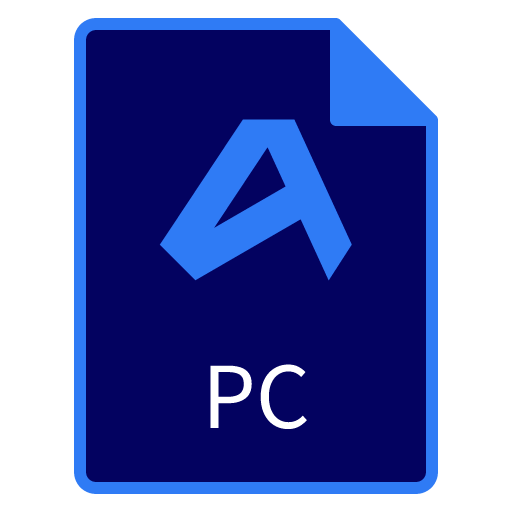
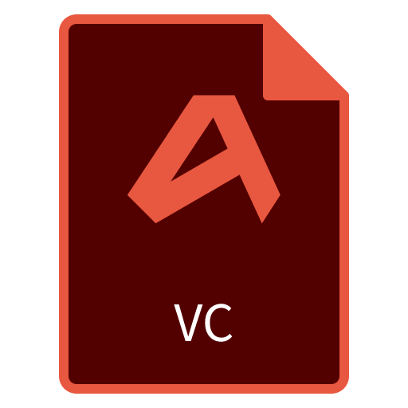
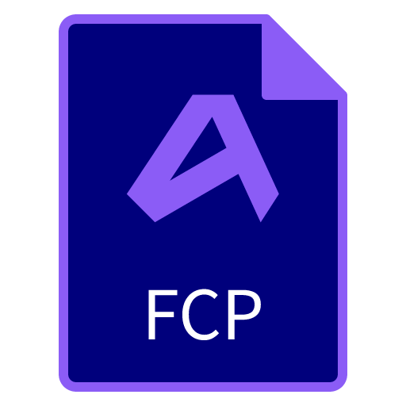
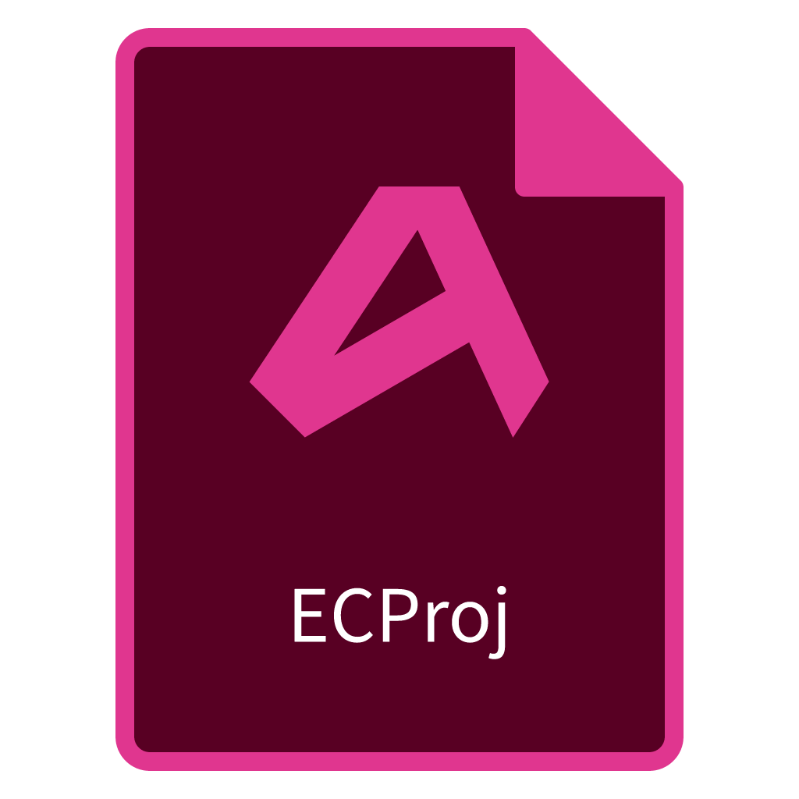
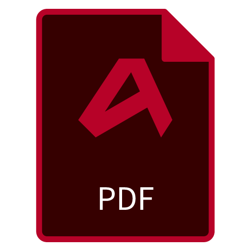
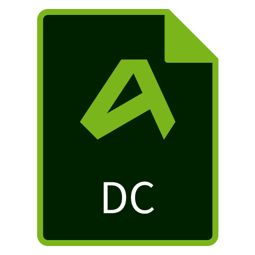
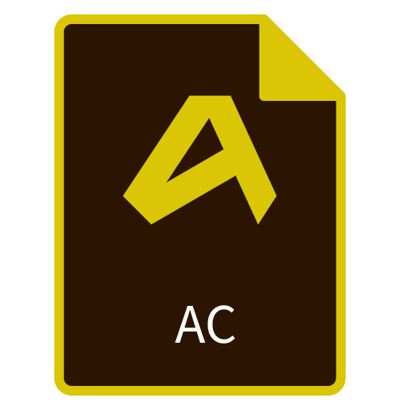
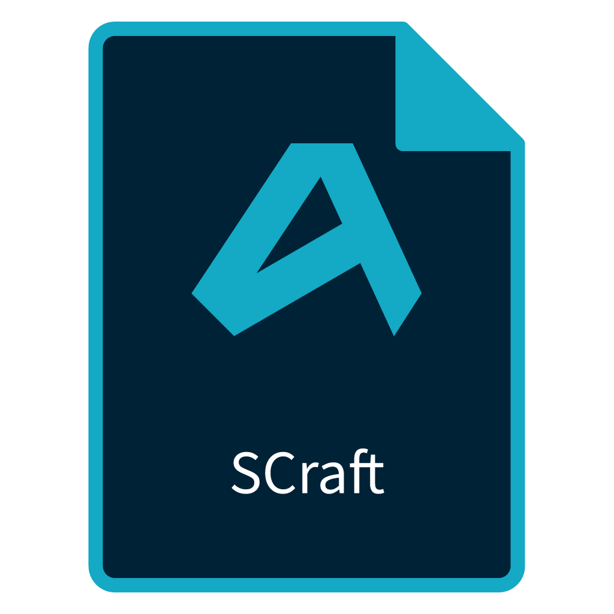
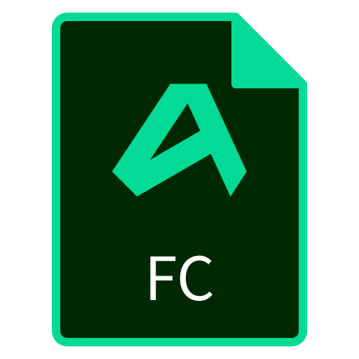

# ArtCraft File Format Icons

Icon set for the file formats used by ArtCraft (e.g. `.pcraft` project files).
Created as a contribution proposal for the project.

<p align="center">
  
</p>

## Design

- **Shape:** a document sheet with a folded top-right corner, identical across all icons.
- **Emblem:** the ArtCraft logo in the center. Only the color and a small badge change between file types; each type uses the color of its related ArtCraft application.
- **Text:** the format name is converted to outlines, so it renders the same on every system.
- **Colors:** taken from the existing ArtCraft application icons to keep the visual identity consistent. The values are written directly in each SVG, so the palette is easy to change if the maintainers prefer different colors.

## Dimensions

All values are in pixels on a 1024×1024 canvas. The origin (0, 0) is the top-left corner, and the Y axis points down.

| Element | Value |
|---------|-------|
| Canvas | 1024 × 1024 |
| Sheet size | 704 × 928 (≈ 3:4) |
| Sheet position | x: 160 → 864, y: 48 → 976 |
| Folded corner | 192 × 192 (≈ 27% of the sheet width), top-right |
| Corner radius | 32 |
| Border width | 24 |
| Emblem area | 384 × 384, centered horizontally, y: 400 → 784 |
| Label baseline | 120 above the bottom edge of the sheet (y = 856) |
| Label max width | 480 |

### Folded corner geometry

The top-right corner of the sheet is cut diagonally at 45°. The fold triangle fills the cut area.

- Cut points: `(672, 48)` on the top edge and `(864, 240)` on the right edge.
- Fold triangle: `(672, 48)`, `(672, 240)`, `(864, 240)`.

## Icons

| Icon |  File  | Description | Label |
|------|--------|-------------|-------|
|  | `.pcraft` | PhotoCraft project file | PC |
|  | `.vectorcraft` | VectorCraft project file | VC |
|  | `.fcproj` | FilmCraft project file | FCP |
|  | `.ecproj` | EffectCraft project file | ECP |
|  | `.pdf` | PDF file | PDF |
|  | `.designcraft` | DesignCraft project file | DC |
|  | `.anicraft` | AniCraft project file | AC |
|  | `.scraft` | SoundCraft project file | SC |
|  | `.figcraft` | FigCraft project file | FC |

## Files

```
icons/
├── svg/      # Editable sources (text converted to outlines)
├── png/      # Exports: 512, 1024
├── source/   # Original .vectorcraft files (optional)
└── README.md
```

- **SVG** is the source of truth. Please edit it, not the PNGs.
- **PNG** files are exported from the SVG, with a transparent background.
- `.ico` / `.icns` are not included; they can be generated from the SVG or the 1024 px PNG.

## Naming convention

Lowercase with hyphens:

- `icon-<type>-project.svg` (full version)
- `<size>-<type>-project.png`

Example: `photocraft-project.svg`, `512-photocraft-project.png`.

## Export settings

Exported from VectorCraft.

- **SVG:** SVG 1.1, text converted to outlines, `viewBox="0 0 1024 1024"`, not minified.
- **PNG:** transparent background, art-optimized anti-aliasing, not interlaced.

## Usage

Feel free to use these icons in ArtCraft and its related tools.
Feedback is welcome through issues or pull requests: colors, sizes, naming, or additional file types.

## License

To be confirmed with the ArtCraft maintainers.

## Author

Designed by **Ahmad Alrashdan** ([@AhmadAlrashdan19](https://github.com/AhmadAlrashdan19)).

Copyright (c) 2026 Ahmad Alrashdan.
The icon designs are available under the license above.

## Credits

The ArtCraft name and logo belong to the [ArtCraft](https://github.com/storytold) project and its authors.
They are used here only to propose icons for the project's file formats.
This repository is not an official ArtCraft release unless the maintainers
state otherwise.
